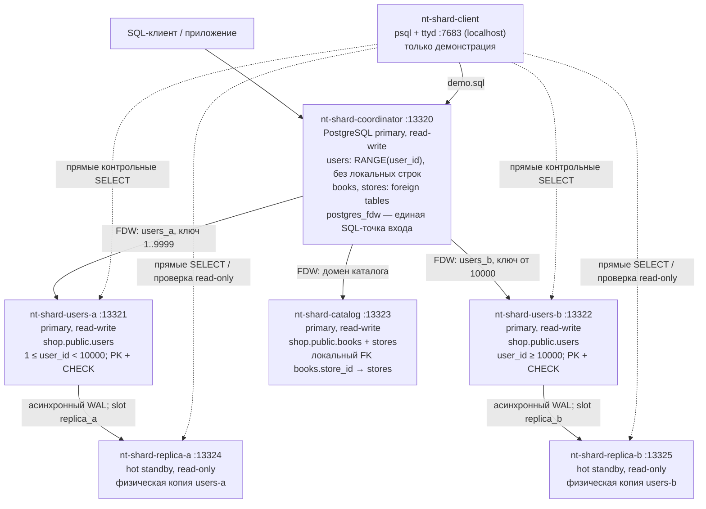

# Домашнее задание к занятию «Репликация и масштабирование. Часть 2» — Павел Логачев

Задание 1 — ответ в свободной форме со ссылками на официальную документацию. Задания 2 и 3* решены на одной схеме: план шардинга из задания 2 развёрнут и проверен на стенде PostgreSQL 16.15 (образ `postgres:16-alpine`) в Docker Compose. Файлы стенда лежат в папке [sharding/](sharding/), полные выводы команд — в [sharding/evidence/](sharding/evidence/). Проверка выполнена 21.10.2026 в Docker Desktop под Windows.

## Задание 1

> Опишите основные преимущества использования масштабирования методами: активный master-сервер и пассивный репликационный slave-сервер; master-сервер и несколько slave-серверов; активный сервер со специальным механизмом репликации — distributed replicated block device (DRBD); SAN-кластер. Дайте ответ в свободной форме.

Источники (прочитаны 21.10.2026):

- [P1] PostgreSQL 16, §27.2 — [Log-Shipping Standby Servers](https://www.postgresql.org/docs/16/warm-standby.html) (потоковая и синхронная репликация, слоты);
- [P2] PostgreSQL 16, §27.4 — [Hot Standby](https://www.postgresql.org/docs/16/hot-standby.html);
- [P3] PostgreSQL 16, §27.3 — [Failover](https://www.postgresql.org/docs/16/warm-standby-failover.html);
- [P4] PostgreSQL 16, §27.1 — [Comparison of Different Solutions](https://www.postgresql.org/docs/16/different-replication-solutions.html) (Shared Disk Failover, Block Device Replication);
- [M1] MySQL 8.0 Reference Manual, глава 19 — [Replication](https://docs.oracle.com/cd/E17952_01/mysql-8.0-en/replication.html) (официальное зеркало Oracle);
- [D1] LINBIT, DRBD 9 User Guide — [DRBD Fundamentals](https://linbit.com/drbd-user-guide/drbd-guide-9_0-en/#ch-fundamentals);
- [D2] LINBIT, DRBD 9 User Guide — [DRBD Features](https://linbit.com/drbd-user-guide/drbd-guide-9_0-en/#s-replication-protocols).

### Активный master и пассивный slave

Преимущества:

- **Готовая копия данных.** На slave постоянно поддерживается актуальная копия базы. При отказе master её повышают до primary (promotion), а не восстанавливают базу из резервной копии. Потоковая репликация WAL почти не нагружает master и не требует менять таблицы [P1].
- **Простая модель записи.** Пишет только один сервер, поэтому не возникает конфликтов одновременных изменений на нескольких master.
- **Плановое обслуживание.** Нагрузку можно переключить на standby, пока master обслуживают [P3].

Чего этот метод не даёт:

- Строго пассивный slave не разгружает чтение. Если разрешить на нём SELECT, это уже hot standby — реплика только для чтения [P1, P2].
- В асинхронном режиме реплика отстаёт, и при аварии master можно потерять подтверждённые транзакции, которые ещё не дошли до slave. В синхронном режиме commit ждёт подтверждения от standby: задержка растёт, а недоступная обязательная standby может заблокировать commit [P1].
- Переключение не происходит само: нужно обнаружить отказ, повысить standby, перенаправить клиентов и не дать старому master продолжить работу (split-brain) [P3]. Реплика не заменяет резервную копию: ошибочное удаление тоже реплицируется.

### Master и несколько slave

Преимущества:

- **Масштабирование чтения.** Записи идут только на master, а SELECT распределяются по репликам. На отдельную реплику можно вынести аналитику и резервное копирование, чтобы не нагружать master. Реплику можно разместить в другом регионе ближе к пользователям [M1].
- **Больше кандидатов на замену.** При обслуживании или отказе master есть из чего выбирать. PostgreSQL поддерживает несколько standby, в том числе каскадную репликацию, которая уменьшает число прямых подключений к primary и трафик между площадками [P1].

Чего этот метод не даёт:

- Запись не масштабируется: все изменения проходят через один master, и каждая реплика применяет весь поток изменений. Нужно разделять чтение и запись в приложении или маршрутизаторе запросов, а асинхронная реплика может вернуть устаревшие данные [M1, P1, P2].
- Растут затраты на хранилище, сеть и администрирование. Долгий запрос на standby может конфликтовать с применением WAL и быть отменён. `hot_standby_feedback` устраняет только конфликты из-за очистки старых версий строк, и за это на primary может накапливаться bloat. Остальные конфликты, например эксклюзивная блокировка от `DROP TABLE` или `DROP DATABASE` на primary, по-прежнему могут отменить запрос или сессию [P2].

### Активный сервер с DRBD

Преимущества:

- **Репликация без общей СХД.** DRBD зеркалирует блочное устройство между локальными дисками двух узлов (shared-nothing). Для приложения и СУБД это прозрачно, специальный SAN не нужен [D1, P4].
- **Обычные файловые системы.** В режиме single-primary используются обычные ext4 или XFS. Это классическая схема отказоустойчивого кластера с переключением [D2].
- **Синхронная запись.** В протоколе C запись считается завершённой только после записи на локальный и на удалённый диск, поэтому при отказе одного узла подтверждённые записи не теряются (если соблюдены условия хранения). Асинхронный протокол A может потерять последние изменения [D2].

Чего этот метод не даёт:

- Устройство на secondary-узле недоступно приложению даже для чтения, поэтому active/passive DRBD не распределяет чтение [D1].
- Приложение, файловую систему и адрес сервиса нужно переключать согласованно и защищаться от split-brain с помощью кворума, кластерного менеджера или fencing [D2]. DRBD не исправляет повреждения файловой системы и не превращает PostgreSQL в multi-master [D1].
- Синхронная запись упирается в задержку сети и производительность дисков. Ошибочные изменения и удаления зеркалируются так же, как правильные, поэтому резервная копия нужна отдельно.

### SAN-кластер

Для PostgreSQL это схема shared-disk failover: несколько вычислительных узлов работают с одним общим дисковым массивом (LUN на SAN). Активен только один сервер. Два независимых процесса PostgreSQL на одном PGDATA одновременно не работают [P4].

Преимущества:

- **Одна копия базы.** Две копии не нужно синхронизировать. При отказе узла резервный сервер монтирует то же хранилище и запускает PostgreSQL как после аварийной перезагрузки. Переключение быстрое, и данные, которые есть на исправной СХД, не теряются [P4].
- **Хранилище отделено от вычислительных узлов.** Сервер можно обслуживать или заменять, не перенося копию базы.

Чего этот метод не даёт:

- Отказ или повреждение общего массива выводит из строя оба узла. Пока работает primary, standby не должен обращаться к общему хранилищу [P4]. Поэтому нужны эксклюзивный доступ (fencing) и отказоустойчивость самой СХД и путей к ней.
- Общая СХД может стать узким местом, а специализированный SAN дорог.
- Общий SAN сам по себе не масштабирует запись PostgreSQL. Режим active-active требует СУБД, кластерной файловой системы и менеджера блокировок, которые его поддерживают [P4, D1].

### Сводка

| Метод | Чтение с резервного узла | Копий данных | Главное преимущество |
|---|---|---|---|
| Master + пассивный slave | нет (строго пассивный) | 2 | быстрое восстановление без restore, простая модель записи |
| Master + несколько slave | да, только чтение | 1 + N | масштабирование чтения, вынос аналитики и бэкапа |
| DRBD (active/passive) | нет | 2, на уровне блочного устройства | синхронная копия без общей СХД |
| SAN-кластер | нет | 1 | одна копия и быстрое переключение вычислительного узла |

## Задание 2

> Разработайте план для выполнения горизонтального и вертикального шаринга базы данных. База данных состоит из трёх таблиц: пользователи, книги, магазины (столбцы произвольно). Опишите принципы построения системы и их разграничение или разбивку между базами данных. Пришлите блоксхему, где и что будет располагаться. Опишите, в каких режимах будут работать сервера.

### Таблицы

- `users(user_id bigint PK, full_name text, email text)` — пользователи;
- `stores(store_id bigint PK, name text, city text)` — магазины;
- `books(book_id bigint PK, title text, store_id bigint → stores, price numeric(10,2) CHECK price >= 0)` — книги.

### Принципы построения

1. **Вертикальный шардинг: разные таблицы на разных серверах, по предметным областям.** Речь не о наращивании CPU и RAM одного сервера и не о разрезании таблицы по столбцам.
   - Пользователи — отдельный домен на своих серверах.
   - Книги и магазины вместе лежат на сервере каталога `nt-shard-catalog`. Их часто соединяют JOIN, и на одном сервере работает обычный локальный внешний ключ `books.store_id → stores.store_id` без распределённой проверки ссылок.
2. **Горизонтальный шардинг пользователей по диапазону `user_id` (RANGE).**
   - `nt-shard-users-a` хранит строки с `1 ≤ user_id < 10000`;
   - `nt-shard-users-b` хранит строки с `user_id ≥ 10000` (верхняя граница — максимум `bigint`, в секции задано `MAXVALUE`).

   Диапазоны не пересекаются, и каждый из них закреплён ограничением `CHECK` на самом шарде, поэтому строку с чужим ключом отвергнет и сам шард при прямой записи в обход координатора. Первичный ключ на каждом шарде вместе с непересекающимися `CHECK` обеспечивает уникальность `user_id` во всей системе. Идентификатор задаёт клиент.

   Почему RANGE: на учебном стенде легко увидеть границу 9999 / 10000. Это не равномерное хеширование: новые записи с растущими ключами скапливаются во втором шарде, а для добавления шардов придётся переносить диапазоны и менять метаданные.
3. **Единая точка входа — координатор `nt-shard-coordinator`.** На нём `postgres_fdw` и таблица `users PARTITION BY RANGE (user_id)`, секции которой — внешние таблицы `users_a` и `users_b`, а также внешние таблицы `books` и `stores`, указывающие на каталог. Приложение пишет и читает обычным SQL через одну таблицу `users`, а PostgreSQL сам выбирает нужный шард. Собственных строк с данными на координаторе нет — только определения таблиц и подключения FDW.
4. **Отказоустойчивость шардов пользователей.** У каждого шарда пользователей есть своя физическая реплика (hot standby) на асинхронной потоковой репликации WAL.

Ограничения плана:

- Внешние ключи между шардами не создаются: `books` и `stores` на `users` не ссылаются.
- Глобальной уникальности `email` нет, поэтому `email` намеренно объявлен без `UNIQUE`.
- `postgres_fdw` не поддерживает двухфазный commit (2PC), поэтому атомарную фиксацию транзакции сразу на нескольких серверах при аварии план не обещает.

### Размещение и режимы серверов

| Сервер | Порт (только 127.0.0.1) | Режим | Что хранит |
|---|---|---|---|
| `nt-shard-coordinator` | 13320 | primary, read-write | собственных строк нет: `users` (RANGE) с внешними секциями `users_a`, `users_b`; внешние таблицы `books`, `stores` |
| `nt-shard-users-a` | 13321 | primary, read-write | `users`, `1 ≤ user_id < 10000`, PK + CHECK |
| `nt-shard-users-b` | 13322 | primary, read-write | `users`, `user_id ≥ 10000`, PK + CHECK |
| `nt-shard-catalog` | 13323 | primary, read-write | `stores` и `books`, локальный FK `books.store_id → stores` |
| `nt-shard-replica-a` | 13324 | hot standby, read-only | физическая копия `users-a`, асинхронный WAL, слот `replica_a` |
| `nt-shard-replica-b` | 13325 | hot standby, read-only | физическая копия `users-b`, асинхронный WAL, слот `replica_b` |
| `nt-shard-client` | 7683 | — | `psql` и веб-терминал ttyd для демонстрации, данных не хранит |

Режимы работы:

- Четыре primary (координатор, два шарда пользователей и каталог) — независимые серверы для чтения и записи, а не multi-master: каждую строку можно изменить только на одном сервере.
- Реплики работают только на чтение. Они созданы через `pg_basebackup` и получают WAL от своего primary асинхронно.
- Координатор направляет запросы только на primary и не распределяет SELECT по репликам. Реплики читаются напрямую — для отчётов и контроля. Отдельного прокси или маршрутизатора в приложении нет.

### Блок-схема

Исходник схемы — [sharding/diagram.md](sharding/diagram.md). Сплошные стрелки показывают поток запросов (FDW) и репликацию WAL, пунктирные — прямые контрольные подключения клиента.



## Задание 3*

> Выполните настройку выбранных методов шардинга из задания 2. Пришлите конфиг Docker и SQL скрипт с командами для базы данных.

### Файлы

Конфиг Docker:

- [sharding/docker-compose.yml](sharding/docker-compose.yml) — шесть серверов PostgreSQL и клиент, healthcheck, зависимости запуска, порты только на 127.0.0.1, именованные тома, SQL инициализации, подключённый в `docker-entrypoint-initdb.d`.

SQL-скрипты:

- [sharding/sql/coordinator.sql](sharding/sql/coordinator.sql) — `postgres_fdw`, внешние серверы, user mapping, `users PARTITION BY RANGE` с внешними секциями, внешние `books` и `stores`;
- [sharding/sql/users-a.sql](sharding/sql/users-a.sql), [sharding/sql/users-b.sql](sharding/sql/users-b.sql) — таблица `users` с PK и `CHECK` диапазона, роли `shard_writer` и `replicator`;
- [sharding/sql/catalog.sql](sharding/sql/catalog.sql) — `stores`, `books` с FK и индексом;
- [sharding/demo.sql](sharding/demo.sql) — запись через координатор, маршрутизация, pruning, прямые SELECT на каждом primary;
- [sharding/sql/replicas.sql](sharding/sql/replicas.sql) — проверка реплик и статуса репликации.

Скрипты:

- [sharding/scripts/primary.sh](sharding/scripts/primary.sh) — разрешает репликацию в `pg_hba.conf` шарда;
- [sharding/scripts/replica.sh](sharding/scripts/replica.sh) — `pg_basebackup` в пустой том и запуск hot standby;
- [sharding/scripts/wait-replicas.sh](sharding/scripts/wait-replicas.sh) — ждёт, пока реплика применит WAL до текущей позиции primary;
- [sharding/scripts/check.sh](sharding/scripts/check.sh) — автоматические проверки;
- [sharding/scripts/client.sh](sharding/scripts/client.sh) — загрузка ttyd 1.7.7 с проверкой SHA256 и запуск терминала;
- [sharding/run.ps1](sharding/run.ps1) — полный прогон из PowerShell;
- [sharding/.gitattributes](sharding/.gitattributes) — LF для shell, SQL, YAML и Markdown.

Реплики не получают отдельный SQL инициализации: схему и роли они берут из физической копии primary.

### Ключевые фрагменты

Горизонтальный шардинг на координаторе ([sql/coordinator.sql](sharding/sql/coordinator.sql)):

```sql
CREATE TABLE public.users (
    user_id bigint NOT NULL,
    full_name text NOT NULL,
    email text NOT NULL
) PARTITION BY RANGE (user_id);
CREATE FOREIGN TABLE public.users_a PARTITION OF public.users
    FOR VALUES FROM (1) TO (10000)
    SERVER users_a OPTIONS (schema_name 'public', table_name 'users');
CREATE FOREIGN TABLE public.users_b PARTITION OF public.users
    FOR VALUES FROM (10000) TO (MAXVALUE)
    SERVER users_b OPTIONS (schema_name 'public', table_name 'users');
```

Граница диапазона на самом шарде ([sql/users-a.sql](sharding/sql/users-a.sql); в [sql/users-b.sql](sharding/sql/users-b.sql) — `CHECK (user_id >= 10000)`):

```sql
CREATE TABLE public.users (
    user_id bigint PRIMARY KEY,
    full_name text NOT NULL,
    email text NOT NULL,
    CONSTRAINT users_range CHECK (user_id >= 1 AND user_id < 10000)
);
```

Вертикальный шардинг — каталог с локальным FK ([sql/catalog.sql](sharding/sql/catalog.sql)):

```sql
CREATE TABLE public.books (
    book_id bigint PRIMARY KEY,
    title text NOT NULL,
    store_id bigint NOT NULL REFERENCES public.stores(store_id),
    price numeric(10,2) NOT NULL CHECK (price >= 0)
);
```

Primary шарда пользователей с настройками для репликации ([docker-compose.yml](sharding/docker-compose.yml)):

```yaml
    command: [postgres, -c, wal_level=replica, -c, max_wal_senders=5, -c, max_replication_slots=5, -c, max_slot_wal_keep_size=256MB]
```

Создание реплики ([scripts/replica.sh](sharding/scripts/replica.sh)):

```bash
  gosu postgres pg_basebackup -h "$PRIMARY_HOST" -U replicator -D "$PGDATA" \
    -Fp -Xs -P -R -C -S "$REPLICA_SLOT" -d "application_name=$REPLICA_SLOT connect_timeout=10"
fi
exec gosu postgres postgres -D "$PGDATA" -c hot_standby=on
```

### Запуск

Из корня репозитория в Windows PowerShell 5.1:

```powershell
powershell -NoProfile -ExecutionPolicy Bypass -File .\sharding\run.ps1
```

Скрипт выполняет по порядку:

1. `docker compose config --quiet`;
2. `docker compose up -d --wait --wait-timeout 180`;
3. `demo.sql` через координатор;
4. `check.sh`;
5. `replicas.sql`;
6. `docker compose ps`.

После каждой команды `docker compose` скрипт проверяет `$LASTEXITCODE` и при ненулевом коде останавливается. SQL инициализации выполняется только на пустых томах. Стенд остаётся запущенным для просмотра; удаление стенда вместе с учебными данными:

```powershell
docker compose -f .\sharding\docker-compose.yml down --volumes
```

### Ход проверки

**1. Стенд запущен.** Шесть серверов PostgreSQL в состоянии `healthy`, клиент работает, все порты опубликованы только на `127.0.0.1`. Команда `docker compose ps` выполнена на хосте, её вывод сохранён в файл и показан в терминале клиента через `cat`: Docker socket в клиентский контейнер не монтировался. Полный вывод — [compose-ps.txt](sharding/evidence/compose-ps.txt), [compose-ps-compact.txt](sharding/evidence/compose-ps-compact.txt).


**2. Конфиг Docker целиком** — три экрана `sed -n` по `docker-compose.yml`. На последнем экране добавлен скрипт создания реплики.


**3. Инициализация.** Docker entrypoint выполнил `10-schema.sql` на четырёх primary и `20-replication.sh` на шардах пользователей: `CREATE ROLE`, `CREATE TABLE`, `CREATE EXTENSION`, `CREATE SERVER`, `CREATE USER MAPPING`, `CREATE FOREIGN TABLE`. Полный лог запуска — [startup.txt](sharding/evidence/startup.txt). Строки `ERROR` в его конце оставили намеренные негативные проверки (шаг 8 и таблица «Результаты автоматических проверок» ниже), а не сбой инициализации.


**4. Маршрутизация через координатор.** `demo.sql` под ролью `app`: `INSERT 0 6` в одну таблицу `users`.

- Строки 1, 42, 9999 попали в секцию `users_a`, строки 10000, 10001, 20000 — в `users_b`.
- JOIN книг и магазинов вернул 2 строки.
- `EXPLAIN` для `user_id=10000` показывает только `Foreign Scan on users_b`: координатор обращается к одному шарду.

На снимке повторный прогон, поэтому `DELETE 6` и `DELETE 2` — это удаление строк предыдущего прогона (скрипт удаляет только свои тестовые строки). Первый прогон с текстом SQL — [demo.txt](sharding/evidence/demo.txt), повтор — [demo-repeat.txt](sharding/evidence/demo-repeat.txt).


**5. Прямые запросы к шардам.**

- На шарде A ровно 1, 42, 9999, на шарде B — 10000, 10001, 20000.
- Оба шарда — primary: `pg_is_in_recovery = f`, `transaction_read_only = off`.


**6. Вертикальное разделение.**

- На каталоге две физические таблицы, `books` и `stores`, JOIN возвращает 2 строки.
- У координатора в схеме `public` 0 физических таблиц.
- На шардах пользователей таблиц `books` и `stores` нет — проверено в `check.sh`.


**7. Реплики.** `wait-replicas.sh` дождался, пока каждая реплика применит WAL до позиции, которую primary имел после записи.

- На обеих репликах `pg_is_in_recovery = t`, `transaction_read_only = on`.
- На replica-a лежат строки 1, 42, 9999, на replica-b — 10000, 10001, 20000.
- WAL receiver в состоянии `streaming` со слотом своего шарда.
- На обоих primary `pg_stat_replication` показывает `streaming` и `async` ([replicas.txt](sharding/evidence/replicas.txt)).


**8. Запрет записи на репликах и итог автоматических проверок.** `INSERT` даже от `postgres` отвергнут на обеих репликах с SQLSTATE 25006 (`cannot execute INSERT in a read-only transaction`), и psql ожидаемо завершился с кодом 1. Весь набор `check.sh` завершился с кодом 0 и выводом `ALL CHECKS PASSED`.


**9. SQL, который настраивает шардинг**, — содержимое `coordinator.sql`, `users-a.sql`, `users-b.sql`, `catalog.sql` в терминале.


### Результаты автоматических проверок

Полный вывод — [checks.txt](sharding/evidence/checks.txt) и повтор [checks-repeat.txt](sharding/evidence/checks-repeat.txt).

| Проверка | Результат |
|---|---|
| Реплики применили WAL primary до текущей позиции | PASS для replica-a и replica-b |
| Строки на `users-a` / `users-b` | `1,42,9999` / `10000,10001,20000` |
| На каждой реплике 3 строки своего диапазона | `t` / `t` |
| `books` и `stores` есть на каталоге и отсутствуют на шардах пользователей | 2 / 0 / 0 |
| Физические таблицы в `public` координатора | 0 |
| `INSERT` с `user_id = 0` через координатор | отвергнут, 23514 (`no partition of relation "users" found for row`) |
| Повтор `user_id = 1` через координатор | отвергнут, 23505 (`duplicate key value violates unique constraint "users_pkey"`) |
| Прямая запись 10000 в `users-a` и 9999 в `users-b` | отвергнута, 23514 (`users_range`) |
| Книга с несуществующим `store_id = 999` | отвергнута, 23503 (`books_store_id_fkey`) |
| `INSERT` на replica-a и replica-b | отвергнут, 25006 |
| Реплики в recovery и read-only | `t` / `t` |
| На каждом primary одна реплика `streaming`, `async` | 1 / 1 |
| Итог | `ALL CHECKS PASSED` |

Полный прогон `run.ps1` в Windows PowerShell 5.1 завершился с кодом процесса 0 и `ALL CHECKS PASSED` — [run-powershell-verified.txt](sharding/evidence/run-powershell-verified.txt). Первая попытка ([run-powershell.txt](sharding/evidence/run-powershell.txt)) прошла все шаги, но внешняя оболочка, перенаправлявшая вывод через `*>`, вернула код 1 из-за `NativeCommandError` на обычных сообщениях о ходе запуска, которые Docker Compose пишет в stderr. Сам `run.ps1` после этого не менялся.

Использованный образ: `postgres@sha256:721873c34ceb9f8d8fc265984940dc982404c105f19ad51be9fdc5970a6080ea` ([image.txt](sharding/evidence/image.txt)). После проверки стенд удалён командой `down --volumes`; контейнеров, томов и сетей `nt-shard-*` не осталось ([cleanup.txt](sharding/evidence/cleanup.txt)).

### Ограничения стенда

- Это одноразовый учебный стенд. Используются аутентификация `trust` и `password_required 'false'` в user mapping, порты открыты только на `127.0.0.1`. Для production нужны SCRAM и TLS, отдельные учётные записи и права, ограниченный `pg_hba.conf`.
- Все контейнеры работают на одном Docker-хосте. У координатора и каталога нет реплик. Автоматического failover, fencing, service discovery нет, повышение реплики до primary не проверялось.
- Репликация — не резервная копия: ошибочный `DELETE` тоже уйдёт на реплику. Резервное копирование и восстановление (backup, PITR, restore) здесь не настраивались.
- Распределённых транзакций с 2PC нет (см. ограничения плана в задании 2).
- Тег `16-alpine` плавающий: при проверке это был PostgreSQL 16.15. Digest записан, но в Compose не закреплён. Клиент при запуске скачивает ttyd с GitHub, загрузка ограничена таймаутом 30 с.
