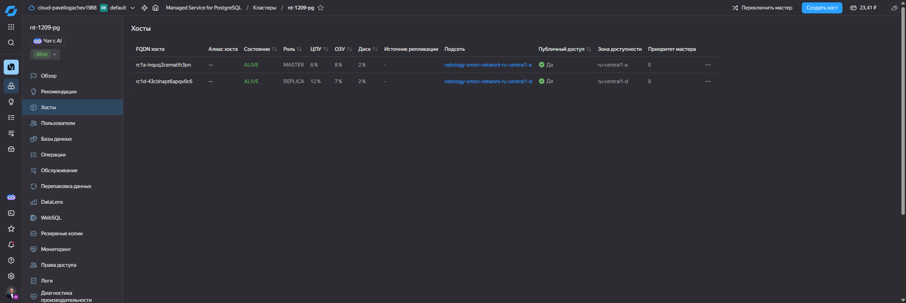
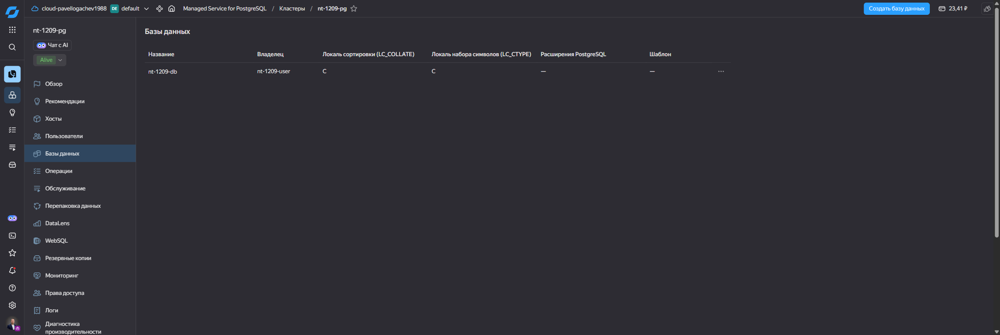
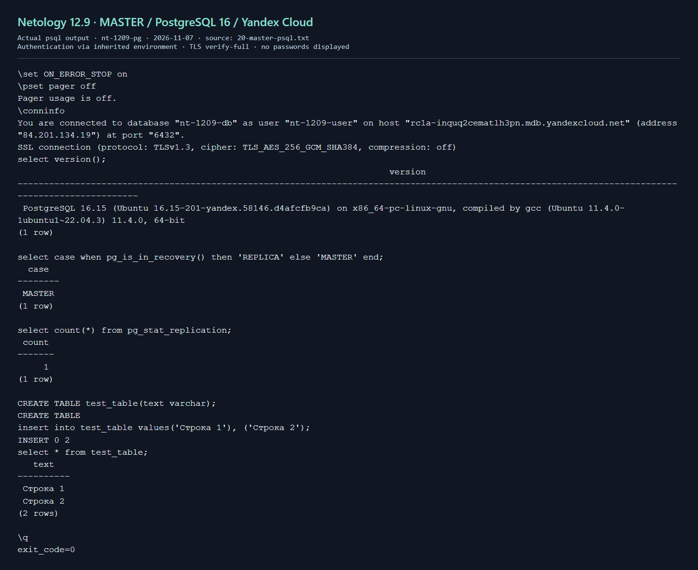
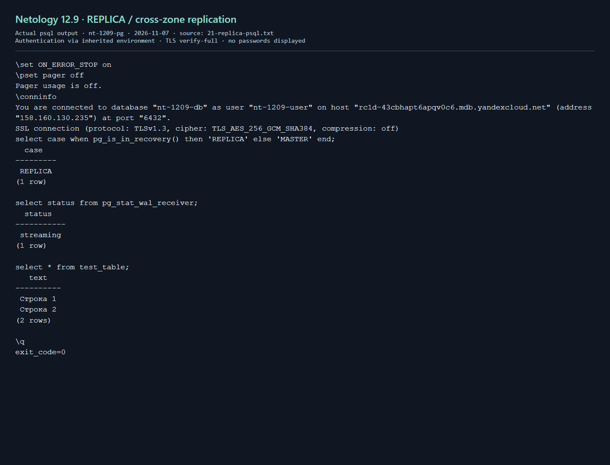
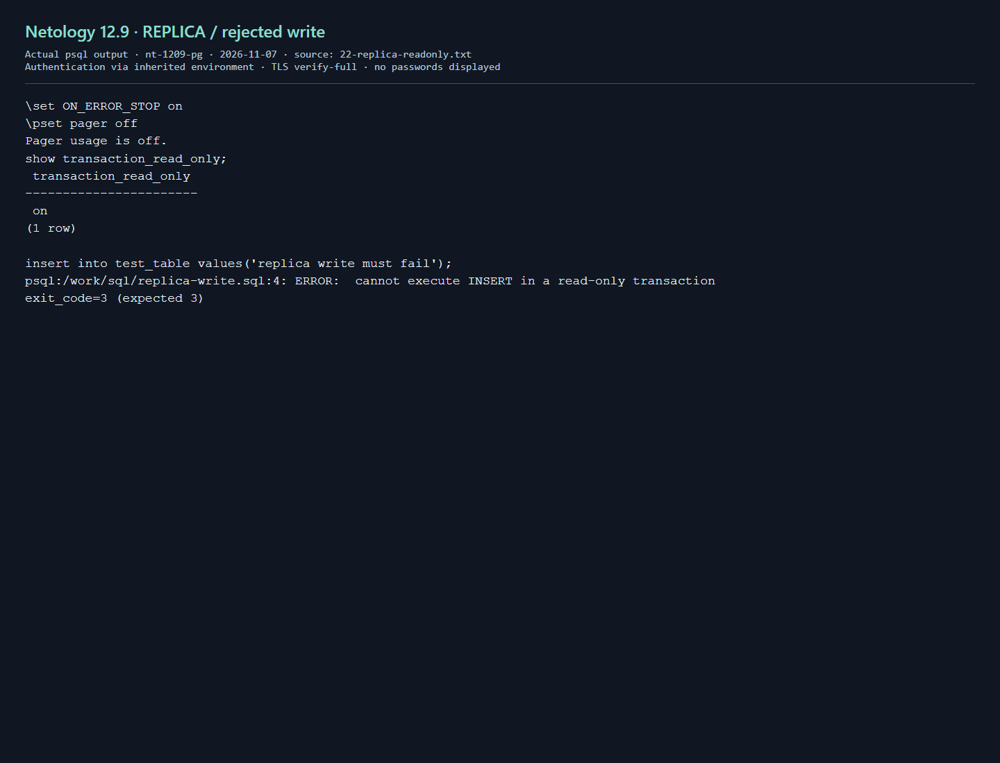

# 12.9. Базы данных в облаке – Павел Логачев

Кластер Managed Service for PostgreSQL я создал 7 ноября 2026 года в своем каталоге Яндекс Облака. Сразу после проверки удалил его: создание запущено в 13:06 по Москве, удаление закончилось в 13:24. Выводы команд и скриншоты лежат в [`cloud-db/evidence/`](cloud-db/evidence/), скрипты подключения и SQL – в [`cloud-db/`](cloud-db/).

## Создание кластера

Параметры кластера `nt-1209-pg`:

- PostgreSQL 16.15, окружение PRODUCTION;
- два хоста в разных зонах доступности: мастер в `ru-central1-a`, реплика в `ru-central1-d`, у обоих включен публичный доступ;
- диск network-ssd 10 ГБ на каждом хосте;
- база `nt-1209-db`, ее владелец – пользователь `nt-1209-user`.

Класс хоста – `s3-c2-m8` (2 vCPU, 8 ГБ), а не `s2.micro` из задания. 23 октября кластеры на `s2.micro` и других классах не создавались из-за ошибки `Not enough resources` (эти попытки сохранены в [`evidence/history/`](cloud-db/evidence/history/)). Поэтому в этот раз я начал с `s3-c2-m8`: у него те же 2 vCPU и 8 ГБ памяти, но новая платформа. Пару зон a+b облако не приняло (`no new resources can be created in zone "ru-central1-b"`), пара a+d создалась, и кластер перешел в статус RUNNING.

Хосты кластера, оба в состоянии Alive:



### Созданная база данных



Описание кластера и хостов из CLI: [10-cluster.json](cloud-db/evidence/10-cluster.json), [11-hosts.json](cloud-db/evidence/11-hosts.json).

## Подключение к мастеру

Команду подключения взял из вкладки «Обзор», сертификат удостоверяющего центра скачал с `https://storage.yandexcloud.net/cloud-certs/CA.pem` и подключался через psql 16.15 с проверкой сертификата (`sslmode=verify-full`). В строке подключения указаны оба хоста и `target_session_attrs=read-write` ([connect-master.sh](cloud-db/connect-master.sh)):

```bash
psql "host=rc1a-inquq2cematlh3pn.mdb.yandexcloud.net,rc1d-43cbhapt6apqv0c6.mdb.yandexcloud.net \
  port=6432 sslmode=verify-full dbname=nt-1209-db user=nt-1209-user target_session_attrs=read-write"
```

Подключение пришло на мастер, к нему подключена одна реплика. На мастере создал таблицу и вставил две строки ([20-master-psql.txt](cloud-db/evidence/20-master-psql.txt)):

```text
select case when pg_is_in_recovery() then 'REPLICA' else 'MASTER' end;
 MASTER

select count(*) from pg_stat_replication;
     1

CREATE TABLE test_table(text varchar);
CREATE TABLE
insert into test_table values('Строка 1'), ('Строка 2');
INSERT 0 2
```



## Проверка репликации

К реплике подключился без `target_session_attrs`, указав только ее хост ([connect-replica.sh](cloud-db/connect-replica.sh)):

```bash
psql "host=rc1d-43cbhapt6apqv0c6.mdb.yandexcloud.net port=6432 sslmode=verify-full dbname=nt-1209-db user=nt-1209-user"
```

Подключение пришло на реплику, она получает журнал в режиме `streaming`. Обе строки, вставленные на мастере в зоне a, читаются на реплике в зоне d ([21-replica-psql.txt](cloud-db/evidence/21-replica-psql.txt)).

### Результат `select * from test_table;` на реплике



Чтобы `pg_stat_wal_receiver` показывал статус, пользователю понадобилась служебная роль `mdb_monitor`. Без нее запрос возвращал строку с пустым статусом, хотя данные на реплику уже пришли.

Дополнительно проверил, что запись на реплике запрещена: `INSERT` возвращает `ERROR: cannot execute INSERT in a read-only transaction` ([22-replica-readonly.txt](cloud-db/evidence/22-replica-readonly.txt)).



## Удаление кластера

Кластер удален, итоговый список кластеров пуст ([90-cluster-list-after.json](cloud-db/evidence/90-cluster-list-after.json)).
