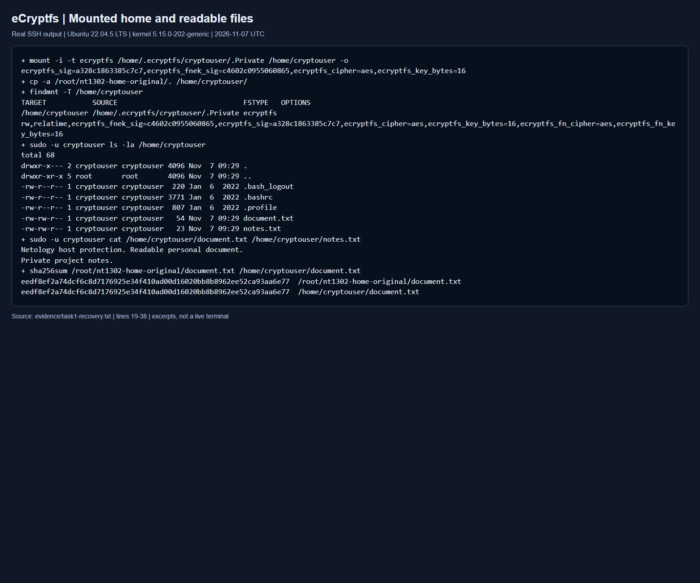
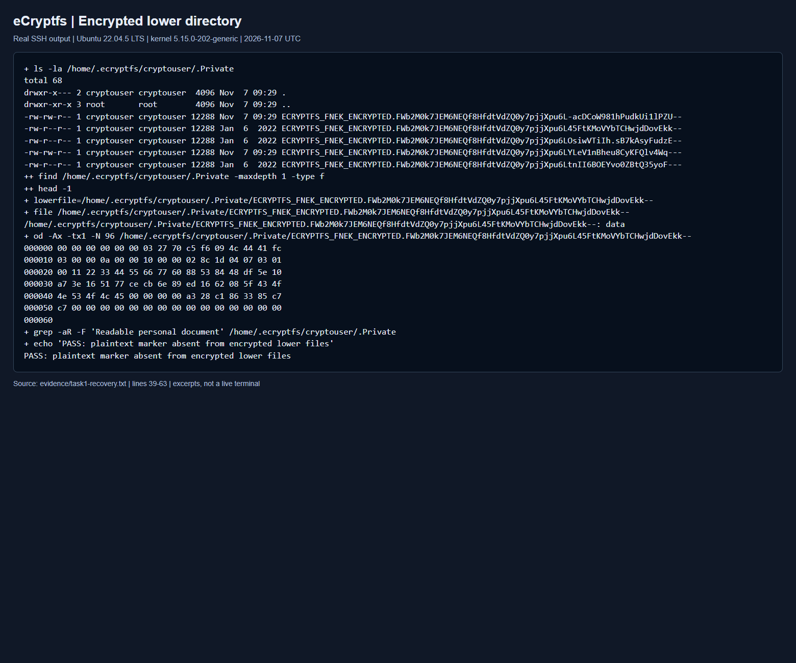
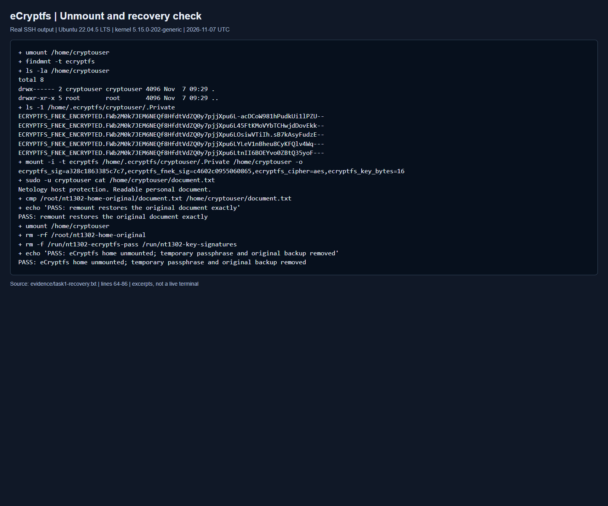
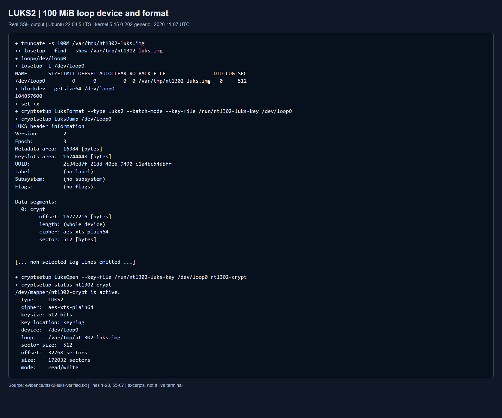
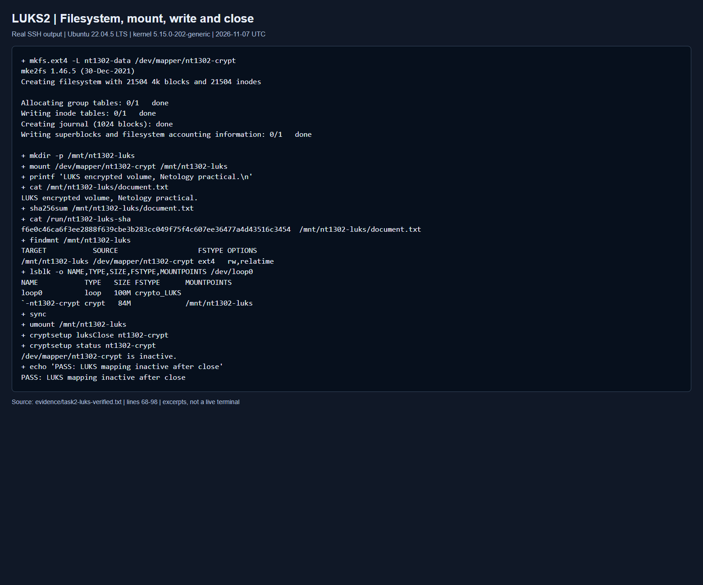
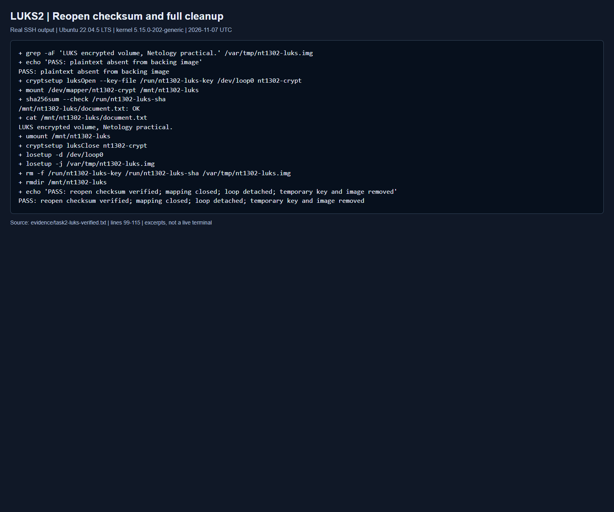
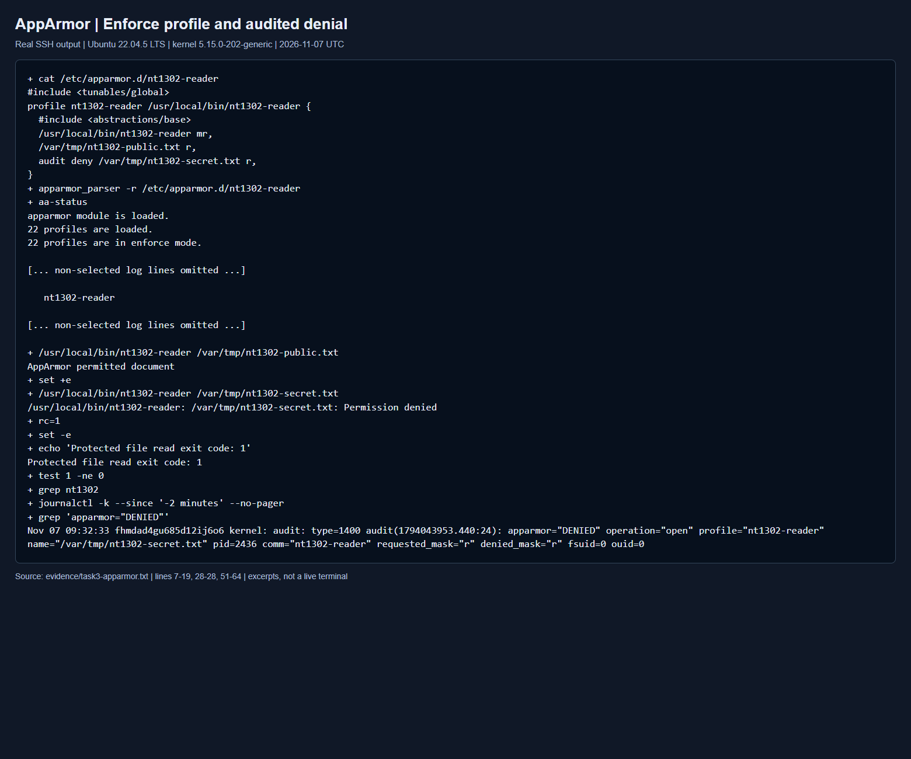
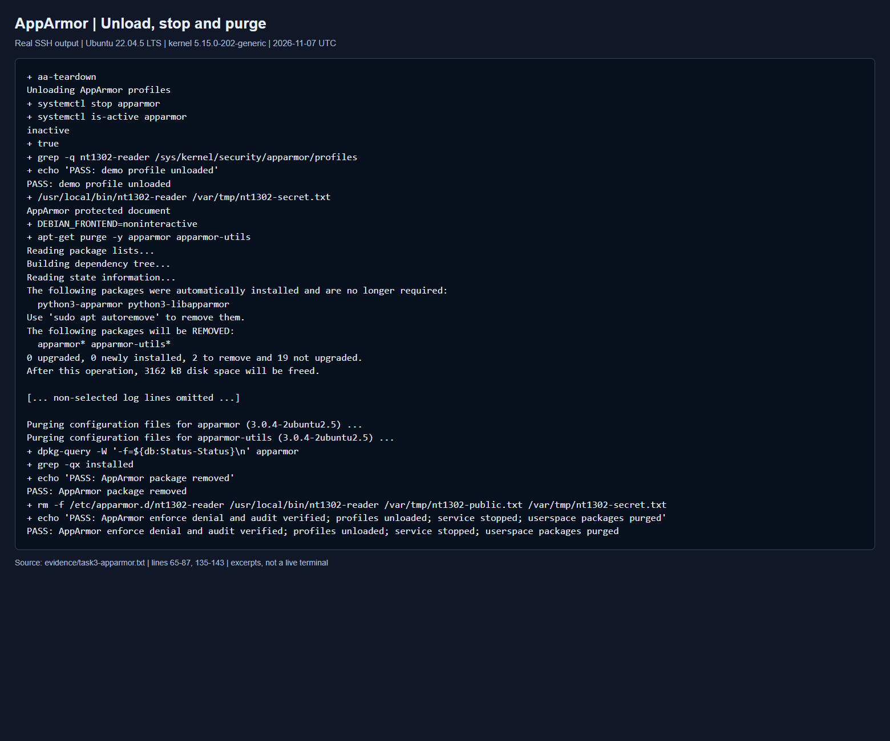

# 13.2. Защита хоста – Павел Логачев

Сначала попробовал сделать работу в Docker Desktop, но в его ядре `7.0.14-linuxkit` нет модуля eCryptfs (`modprobe: FATAL: Module ecryptfs not found`, [docker-probe.txt](evidence/docker-probe.txt)). Поэтому все задания я выполнил 7 ноября 2026 года на временной виртуальной машине в Яндекс Облаке: Ubuntu 22.04.5 LTS, ядро `5.15.0-202-generic`, 2 vCPU, 2 ГБ памяти. Версии пакетов: ecryptfs-utils 111-5ubuntu1, cryptsetup 2.4.3, apparmor 3.0.4. После работы машина и ее диск удалены ([cleanup.txt](evidence/cleanup.txt)).

Скрипты, которые я запускал, лежат в [`evidence/commands/`](evidence/commands/), полные выводы с трассировкой `set -x` – в [`evidence/`](evidence/). Скриншоты собраны из этих выводов. Пароли для шифрования были одноразовыми и в репозиторий не попали.

## Задание 1. eCryptfs

```bash
apt-get install -y ecryptfs-utils keyutils
useradd --create-home --shell /bin/bash cryptouser
# ключи шифрования содержимого и имен файлов кладутся в keyring
ecryptfs-add-passphrase --fnek < passphrase-file
# шифрованный нижний каталог монтируется на место домашнего
mount -i -t ecryptfs /home/.ecryptfs/cryptouser/.Private /home/cryptouser \
  -o ecryptfs_sig=<sig>,ecryptfs_fnek_sig=<fnek_sig>,ecryptfs_cipher=aes,ecryptfs_key_bytes=16
```

В домашний каталог cryptouser я положил тестовые файлы `document.txt` и `notes.txt`. Пока каталог смонтирован, пользователь видит их как обычные файлы, а SHA-256 документа совпадает с исходным:



На диске те же файлы лежат в `/home/.ecryptfs/cryptouser/.Private`. Имена зашифрованы (`ECRYPTFS_FNEK_ENCRYPTED.…`), утилита `file` определяет содержимое как `data`, а поиск строки из документа по этому каталогу ничего не находит:



После `umount` домашний каталог пуст, а данные остаются на диске только в зашифрованном виде в `.Private`. После повторного монтирования документ снова читается и побайтно совпадает с исходным (`cmp`):



Монтирование я делал вручную от root. Автоматическое монтирование при входе пользователя через PAM не настраивал.

Полный вывод: [task1-recovery.txt](evidence/task1-recovery.txt). Первая попытка ([task1-ecryptfs.txt](evidence/task1-ecryptfs.txt)) упала с ошибкой `mount(2) system call failed: No such file or directory`: ключи попали в keyring подоболочки, и ядро их не нашло. Во второй попытке ключи добавляются в keyring текущего сеанса.

## Задание 2. LUKS

На машине был только системный диск, поэтому раздел 100 МБ я сделал на loop-устройстве поверх файла:

```bash
apt-get install -y cryptsetup
truncate -s 100M /var/tmp/nt1302-luks.img
losetup --find --show /var/tmp/nt1302-luks.img
cryptsetup luksFormat --type luks2 --batch-mode --key-file <keyfile> /dev/loopN
cryptsetup luksDump /dev/loopN
cryptsetup luksOpen --key-file <keyfile> /dev/loopN nt1302-crypt
cryptsetup status nt1302-crypt
mkfs.ext4 -L nt1302-data /dev/mapper/nt1302-crypt
mount /dev/mapper/nt1302-crypt /mnt/nt1302-luks
echo 'LUKS encrypted volume, Netology practical.' > /mnt/nt1302-luks/document.txt
umount /mnt/nt1302-luks
cryptsetup luksClose nt1302-crypt
```

Создание раздела, форматирование в LUKS2 и открытие. `cryptsetup status` показывает шифр AES-XTS с ключом 512 бит:



Файловая система, монтирование, запись файла и закрытие раздела. Расшифрованное устройство имеет размер 84 МБ: первые 16 МБ раздела занимает заголовок LUKS2.



Проверка: в самом файле-разделе текст тестового файла не находится, а после повторного открытия контрольная сумма файла совпадает (`sha256sum --check` – `OK`):



Полный вывод: [task2-luks-verified.txt](evidence/task2-luks-verified.txt).

## Задание 3*. AppArmor

Какой именно опыт показывали в лекции, я не знаю, поэтому сделал стандартный. Скопировал `/bin/cat` в `/usr/local/bin/nt1302-reader` и написал для него профиль: чтение одного тестового файла разрешено, другого явно запрещено (`audit deny`). После загрузки профиля в режиме enforce разрешенный файл читается, а запрещенный дает `Permission denied`, и в журнале ядра появляется запись `apparmor="DENIED"`:



Затем выгрузил профили (`aa-teardown`), остановил службу и удалил пакеты `apt-get purge -y apparmor apparmor-utils`. Тот же файл после этого читается без ошибки. Модуль безопасности AppArmor в работающем ядре при этом остается, удаляются пакет и профили.



Полный вывод: [task3-apparmor.txt](evidence/task3-apparmor.txt).
