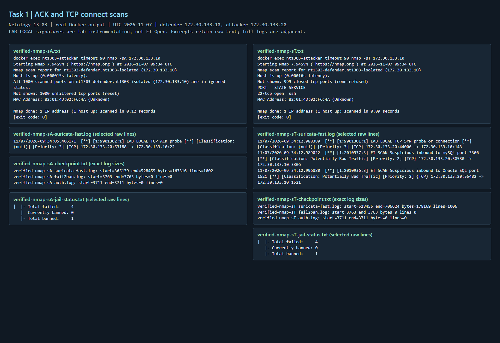
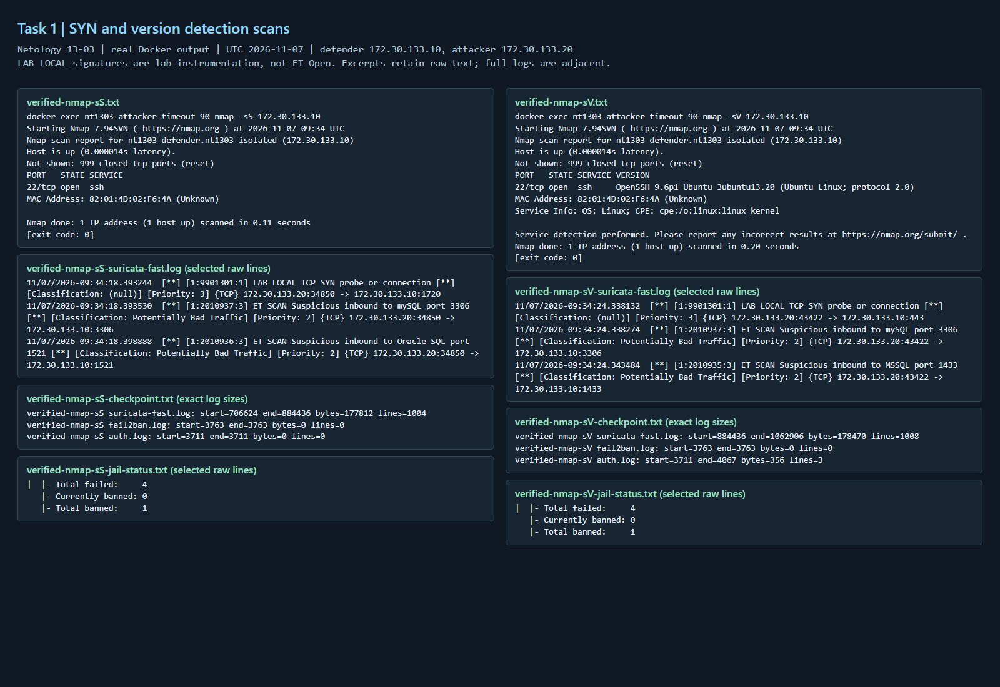
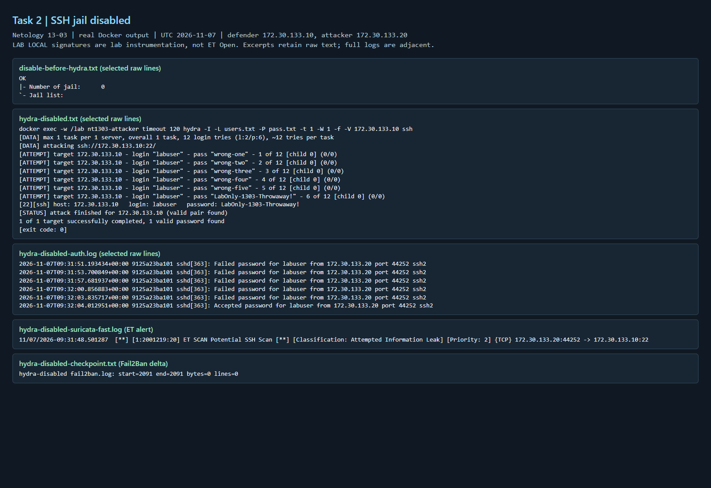
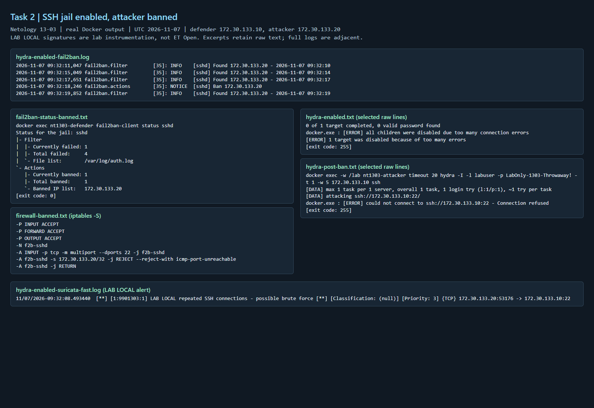

# 13.3. Защита сети – Павел Логачев

Работу я делал 7 ноября 2026 года на двух контейнерах в Docker Desktop. Оба собраны из одного образа на Ubuntu 24.04 и стоят в изолированной сети `172.30.133.0/24` без выхода наружу:

- защищаемая система `172.30.133.10`: Suricata 7.0.3, Fail2Ban 1.0.2, OpenSSH 9.6p1;
- система злоумышленника `172.30.133.20`: Nmap 7.94SVN и Hydra 9.5.

Suricata слушает интерфейс `eth0` через AF_PACKET. Правила – ET Open, загруженные через `suricata-update` (53 334 правила загружено без ошибок). Кроме них я добавил три локальных правила с пометкой `LAB LOCAL` ([local.rules](stand/local.rules)): на SYN-пакет, на «голый» ACK и на частые подключения к SSH. Первые два нужны, чтобы видеть в логе каждый пакет сканирования, сами по себе атаку они не доказывают.

Файлы стенда лежат в [`stand/`](stand/), логи по каждому этапу – в [`evidence/`](evidence/), полный список файлов – в [INDEX.md](evidence/INDEX.md). После работы контейнеры, сеть и образ удалены ([cleanup.txt](evidence/cleanup.txt)).

## Задание 1. Разведка

На атакующей машине запустил четыре скана по стандартным 1000 портам. Перед каждым запуском фиксировал размер логов Suricata, Fail2Ban и `auth.log`, после запуска сохранял только новые строки.

```bash
nmap -sA 172.30.133.10
nmap -sT 172.30.133.10
nmap -sS 172.30.133.10
nmap -sV 172.30.133.10
```

Результат Nmap: из 1000 портов открыт только `22/tcp ssh`, `-sV` определил `OpenSSH 9.6p1 Ubuntu 3ubuntu13.20`. ACK-скан показывает все 1000 портов как `unfiltered`: он проверяет только наличие фильтрации, а открыт порт или закрыт, не определяет.





### События в логах

| Скан | Suricata, правила ET Open | Fail2Ban | auth.log |
|---|---|---|---|
| `-sA` | нет (только локальное правило на ACK) | новых записей нет | новых записей нет |
| `-sT` | 5 срабатываний: MySQL 3306, Oracle 1521, MSSQL 1433, PostgreSQL 5432, VNC 5800–5820 | новых записей нет | новых записей нет |
| `-sS` | 4 срабатывания: MySQL, Oracle, MSSQL, PostgreSQL | новых записей нет | новых записей нет |
| `-sV` | 4 срабатывания: MySQL, Oracle, MSSQL, PostgreSQL | новых записей нет | 3 строки: подключение и разрыв до обмена ключами |

Пример срабатывания ET Open ([verified-nmap-sT-suricata-fast.log](evidence/verified-nmap-sT-suricata-fast.log)):

```text
[1:2010937:3] ET SCAN Suspicious inbound to mySQL port 3306 [Classification: Potentially Bad Traffic] {TCP} 172.30.133.20:58530 -> 172.30.133.10:3306
```

Строки `auth.log` при `-sV` ([verified-nmap-sV-auth.log](evidence/verified-nmap-sV-auth.log)):

```text
sshd[925]: Connection from 172.30.133.20 port 50406 on 172.30.133.10 port 22
sshd[925]: kex_exchange_identification: Connection closed by remote host
sshd[925]: Connection closed by 172.30.133.20 port 50406
```

**Комментарий.** Suricata видит сканирование на уровне сети. Правила ET Open срабатывают на обращения к портам популярных баз данных и VNC: сами эти службы на машине не установлены, и Nmap показал их порты закрытыми, но обращение к ним типично для разведки. ACK-скан правила ET Open не заметили, его видно только по моему локальному правилу. Fail2Ban на сканирование не реагирует: он читает журнал sshd и ищет неудачные входы, а при сканировании никто не пытался войти. Даже при `-sV`, когда Nmap подключился к SSH, чтобы прочитать баннер, в журнале появилась только запись о подключении без ошибки пароля, поэтому фильтр sshd ничего не нашел.

Первые два скана я запустил раньше, чем Suricata закончила загрузку правил, и в ее логах они не появились. В таблице и на скриншотах – повторный прогон всех четырех сканов после строки `Engine started.` ([verified-scans-readiness.txt](evidence/verified-scans-readiness.txt)).

## Задание 2. Подбор пароля к SSH

Файлы для Hydra: [users.txt](stand/users.txt) (2 имени) и [pass.txt](stand/pass.txt) (6 паролей). Для эксперимента в них есть реально существующий на стенде пользователь `labuser` и его одноразовый пароль.

### Без защиты

Сначала jail `sshd` был выключен (`Number of jail: 0`):

```bash
hydra -I -L users.txt -P pass.txt -t 1 -W 1 -f -V 172.30.133.10 ssh
```

Hydra перебрала 12 комбинаций и нашла пароль: `[22][ssh] host: 172.30.133.10 login: labuser password: LabOnly-1303-Throwaway!` ([hydra-disabled.txt](evidence/hydra-disabled.txt)). В `auth.log` пять строк `Failed password for labuser` и затем `Accepted password for labuser`. Fail2Ban за это время ничего не записал. Suricata выдала `ET SCAN Potential SSH Scan` (правило срабатывает на 5 подключений к SSH за 120 секунд).



### С защитой Fail2Ban

В задании сказано включить секцию ssh прямо в `/etc/fail2ban/jail.conf`. Я сделал то же самое через [jail.local](stand/jail.local): Fail2Ban читает его поверх `jail.conf`, а сам `jail.conf` при обновлении пакета перезаписывается. Итоговые настройки ([jail-enabled.observed.local](stand/jail-enabled.observed.local)):

```ini
[sshd]
enabled  = true
maxretry = 3
findtime = 120
bantime  = 600
banaction = iptables-multiport
```

Тот же запуск Hydra закончился ошибкой: `0 valid password found`, `[ERROR] all children were disabled due too many connection errors` ([hydra-enabled.txt](evidence/hydra-enabled.txt)). Журнал Fail2Ban ([hydra-enabled-fail2ban.log](evidence/hydra-enabled-fail2ban.log)):

```text
09:32:11 [sshd] Found 172.30.133.20
09:32:15 [sshd] Found 172.30.133.20
09:32:17 [sshd] Found 172.30.133.20
09:32:18 [sshd] Ban 172.30.133.20
```

`fail2ban-client status sshd` показывает `Currently banned: 1`, `Banned IP list: 172.30.133.20`. В iptables появилось правило:

```text
-A f2b-sshd -s 172.30.133.20/32 -j REJECT --reject-with icmp-port-unreachable
```

После бана даже вход с правильным паролем не проходит: `could not connect to ssh://172.30.133.10:22 - Connection refused` ([hydra-post-ban.txt](evidence/hydra-post-ban.txt)). Suricata в этом окне выдала срабатывание локального правила на частые подключения к SSH; правило ET Open на этот раз не сработало.



**Комментарий.** Suricata видит атаку по характеру трафика: много подключений к порту 22 за короткое время. Сами пароли она не видит, потому что SSH зашифрован, и атаку не останавливает: она работает как IDS и только пишет события. Fail2Ban, наоборот, ничего не знает о трафике, но читает журнал sshd. После трех неудачных входов за 120 секунд он добавил адрес атакующего в iptables на 10 минут. Без Fail2Ban пароль был подобран, с ним Hydra отключилась после бана. Вместе они дополняют друг друга: Suricata замечает и сканирование, и подбор, Fail2Ban блокирует подбор.
