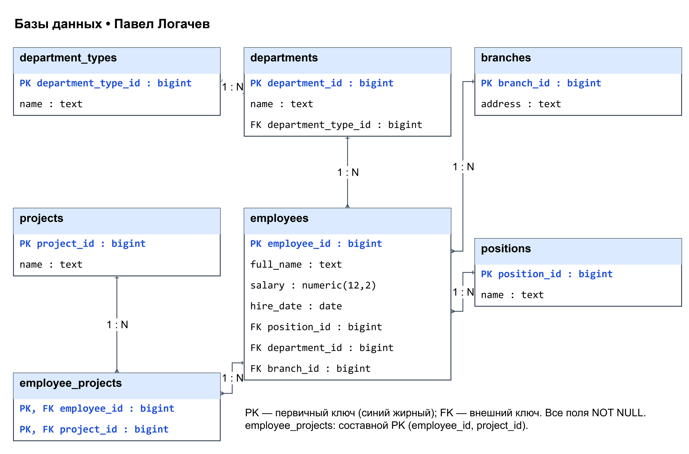
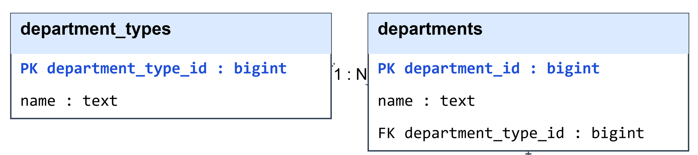
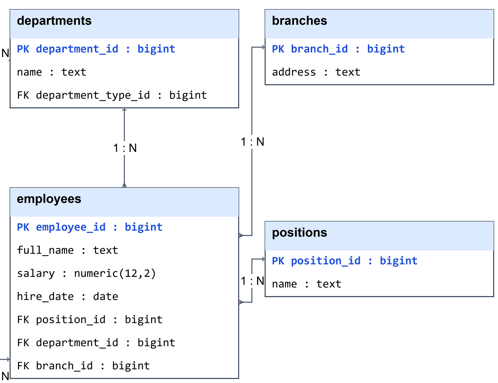
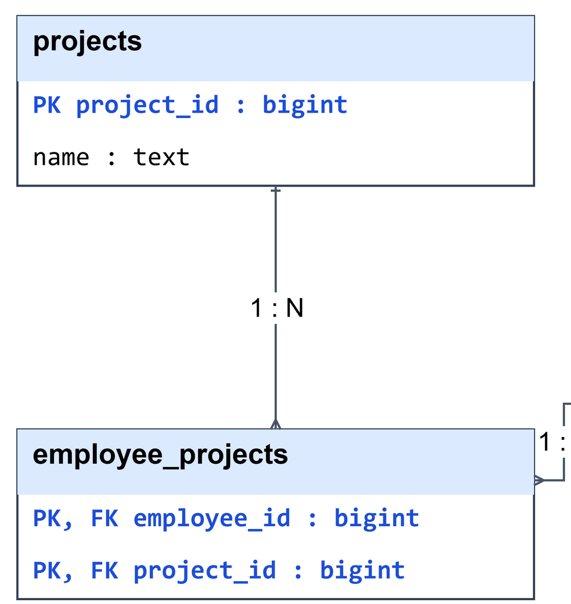
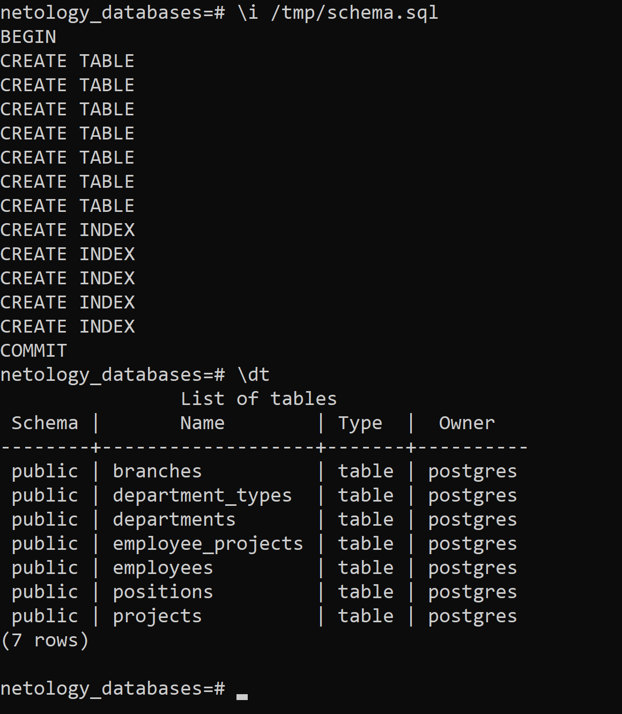

# Домашнее задание к занятию «Базы данных» — Павел Логачев

## 1. Модель данных

В [исходном Excel](https://github.com/netology-code/sdb-homeworks/blob/main/resources/hw-12-1.xlsx) один лист, 29 сотрудников и восемь столбцов. Разделил данные на сотрудников, справочники и назначения на проекты. Получилось семь таблиц: повторяющиеся названия хранятся отдельно, а несколько проектов сотрудника связаны через таблицу назначений.

| Столбец отчёта | Где хранится |
|---|---|
| ФИО сотрудника | `employees.full_name` |
| Оклад | `employees.salary` |
| Должность | `positions.name`, FK из `employees.position_id` |
| Тип подразделения | `department_types.name`, FK из `departments.department_type_id` |
| Структурное подразделение | `departments.name`, FK из `employees.department_id` |
| Дата найма | `employees.hire_date` |
| Адрес филиала | `branches.address`, FK из `employees.branch_id` |
| Проект на который назначен | `projects.name`, назначения в `employee_projects` |

### employees

Сотрудники, их оклады и даты найма. Должность, подразделение и филиал связаны с сотрудниками как 1:N.

| Столбец | Тип PostgreSQL | PK/FK |
|---|---|---|
| `employee_id` | `bigint` | PK |
| `full_name` | `text` | — |
| `salary` | `numeric(12,2)` | — |
| `hire_date` | `date` | — |
| `position_id` | `bigint` | FK → `positions.position_id` |
| `department_id` | `bigint` | FK → `departments.department_id` |
| `branch_id` | `bigint` | FK → `branches.branch_id` |

### positions

Справочник должностей. Связь `positions` → `employees`: 1:N; оклад хранится у сотрудника.

| Столбец | Тип PostgreSQL | PK/FK |
|---|---|---|
| `position_id` | `bigint` | PK |
| `name` | `text` | — |

### department_types

Типы подразделений: «Отдел», «Группа», «Департамент». Связь с `departments`: 1:N.

| Столбец | Тип PostgreSQL | PK/FK |
|---|---|---|
| `department_type_id` | `bigint` | PK |
| `name` | `text` | — |

### departments

Структурные подразделения и их типы. Связь `departments` → `employees`: 1:N.

| Столбец | Тип PostgreSQL | PK/FK |
|---|---|---|
| `department_id` | `bigint` | PK |
| `name` | `text` | — |
| `department_type_id` | `bigint` | FK → `department_types.department_type_id` |

### branches

Филиалы, различаемые по полному адресу. Связь `branches` → `employees`: 1:N.

| Столбец | Тип PostgreSQL | PK/FK |
|---|---|---|
| `branch_id` | `bigint` | PK |
| `address` | `text` | — |

### projects

Названия отдельных проектов. Связь `projects` → `employee_projects`: 1:N.

| Столбец | Тип PostgreSQL | PK/FK |
|---|---|---|
| `project_id` | `bigint` | PK |
| `name` | `text` | — |

### employee_projects

Назначения сотрудников на проекты. Две связи 1:N с `employees` и `projects` реализуют M:N между сотрудниками и проектами.

| Столбец | Тип PostgreSQL | PK/FK |
|---|---|---|
| `employee_id` | `bigint` | Часть PK, FK → `employees.employee_id` |
| `project_id` | `bigint` | Часть PK, FK → `projects.project_id` |

### Типы и ограничения

Для оклада выбрал точный `numeric(12,2)`, для даты без времени — `date`, для ФИО, адреса и названий — `text`. Шесть технических PK имеют тип `bigint` и `GENERATED ALWAYS AS IDENTITY`; ФИО ключом не служит. Составной PK `(employee_id, project_id)` исключает повторное назначение. Все столбцы `NOT NULL`; названия справочников и адреса уникальны, у подразделений уникальна пара `(department_type_id, name)`. Оклад неотрицательный. При удалении сотрудника удаляются его назначения; остальные используемые записи защищены FK.

Даты в отчёте записаны числами в формате ДДММГГ без ведущего нуля: `31217` → `2017-12-03`. Несколько проектов в одной ячейке перечислены через запятую в фигурных скобках. Адрес связан с сотрудником, а не с подразделением: одно подразделение встречается в отчёте по разным адресам.

### Схема

[Исходник draw.io](databases/schema.drawio), [полный PNG](databases/evidence/schema-full.png). Синим жирным выделены PK; указаны все столбцы, типы и связи.



Крупные фрагменты:







## 2*. PostgreSQL

Запустил PostgreSQL 18.6 в Docker, создал новую БД `netology_databases` и выполнил [schema.sql](databases/schema.sql). В `psql` получены `COMMIT` и семь таблиц в ответе на `\dt`.



[Оригинальный снимок терминала](databases/evidence/psql-terminal.png). Диаграмма — [схема из задания 1](databases/evidence/schema-full.png), SQL создаёт ровно её. Структуру созданной БД проверил запросом [verify.sql](databases/verify.sql): 7 таблиц, 7 PK, 6 FK ([результат](databases/evidence/verification.txt)).

Как повторить (после запуска контейнера дождаться готовности PostgreSQL):

```sh
docker run -d --name netology-12-01-postgres -e POSTGRES_PASSWORD=netology_local_lab postgres:18.6
docker exec netology-12-01-postgres createdb -U postgres netology_databases
docker cp databases/schema.sql netology-12-01-postgres:/tmp/schema.sql
docker exec netology-12-01-postgres psql -U postgres -d netology_databases -v ON_ERROR_STOP=1 -f /tmp/schema.sql
docker exec netology-12-01-postgres psql -U postgres -d netology_databases -c '\dt'
```
