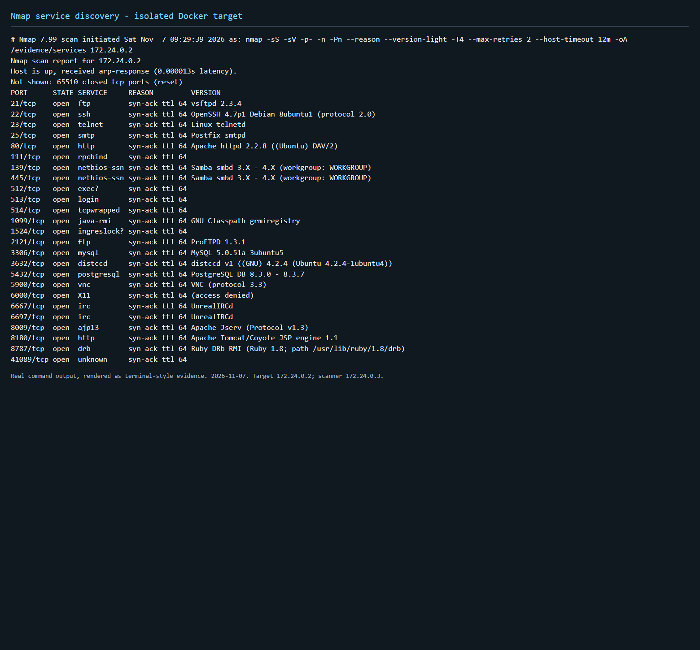
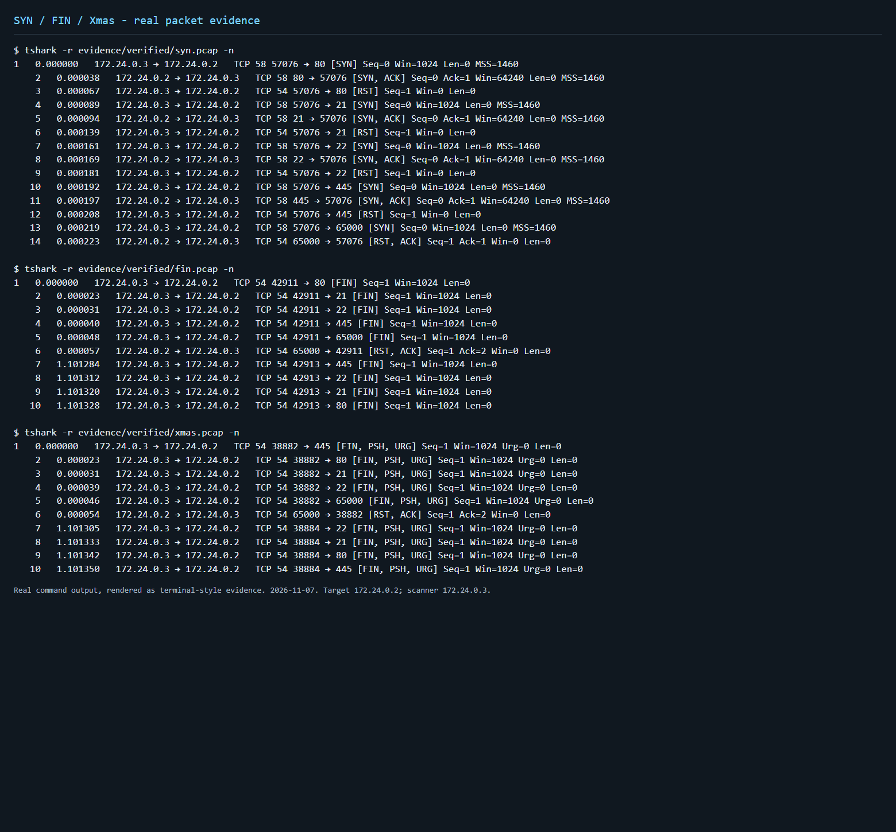
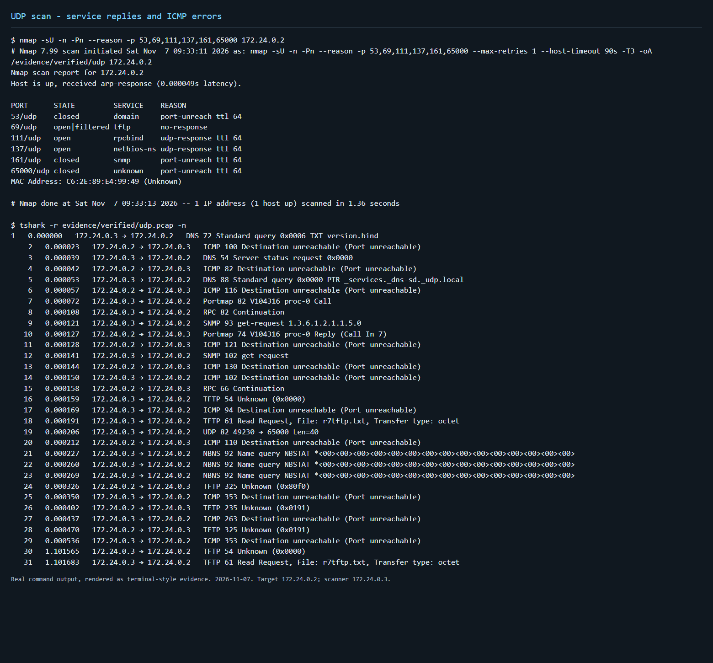

# 13.1. Уязвимости и атаки на информационные системы – Павел Логачев

Работу я делал 7 ноября 2026 года на одноразовом стенде в Docker Desktop. Целью была Metasploitable 2 из образа `tleemcjr/metasploitable2`: это не полноценная VM, а контейнер с ее файловой системой и службами. Сканером был контейнер `nicolaka/netshoot` с Nmap 7.99. Оба контейнера стояли в изолированной сети `172.24.0.0/16` без выхода наружу: цель `172.24.0.2`, сканер `172.24.0.3`. Трафик я записывал tcpdump в сетевом пространстве цели и разбирал в TShark 4.6.6 (консольный Wireshark). Файлы `.pcap` открываются и в обычном Wireshark.

Выводы, файлы захвата и команды лежат в [`evidence/`](evidence/). После проверки контейнеры и сеть удалены ([cleanup.txt](evidence/cleanup.txt)).

## Задание 1

Сначала просканировал все TCP-порты с определением версий:

```bash
nmap -sS -sV -p- -n -Pn --reason --version-light -T4 --max-retries 2 --host-timeout 12m -oA /evidence/services 172.24.0.2
```

Nmap нашел 25 открытых TCP-портов из 65535 ([services.nmap](evidence/services.nmap)). Версии Samba и IRC-сервера уточнил отдельным запуском со скриптами `smb-os-discovery` и `irc-info` ([versions-confirmed.nmap](evidence/versions-confirmed.nmap)).



### Какие сетевые службы разрешены

| Порт | Служба и версия по Nmap |
|---|---|
| 21/tcp | FTP, vsftpd 2.3.4 |
| 22/tcp | SSH, OpenSSH 4.7p1 Debian 8ubuntu1 |
| 23/tcp | Telnet, Linux telnetd |
| 25/tcp | SMTP, Postfix smtpd |
| 80/tcp | HTTP, Apache httpd 2.2.8 (Ubuntu) DAV/2 |
| 111/tcp | rpcbind |
| 139, 445/tcp | Samba smbd 3.0.20-Debian |
| 512, 513, 514/tcp | r-службы (exec, login; 514 Nmap показал как tcpwrapped) |
| 1099/tcp | Java RMI, GNU Classpath grmiregistry |
| 1524/tcp | ingreslock: на обычный запрос Nmap порт сразу отдал приглашение root-шелла |
| 2121/tcp | FTP, ProFTPD 1.3.1 |
| 3306/tcp | MySQL 5.0.51a-3ubuntu5 |
| 3632/tcp | distccd v1 |
| 5432/tcp | PostgreSQL 8.3.0–8.3.7 |
| 5900/tcp | VNC, протокол 3.3 |
| 6000/tcp | X11 (доступ запрещен) |
| 6667, 6697/tcp | IRC, UnrealIRCd 3.2.8.1 |
| 8009/tcp | AJP 1.3 |
| 8180/tcp | HTTP, Apache Tomcat/Coyote JSP engine 1.1 |
| 8787/tcp | Ruby DRb |
| 41089/tcp | Nmap службу не определил, по netstat на цели это rmiregistry |

По UDP я проверял только выбранные порты: открыты 111/rpcbind и 137/netbios-ns, порт 69/tftp получил статус `open|filtered`.

### Какие уязвимости обнаружены

Для трех служб версия, найденная Nmap, совпала с уязвимой версией из записей Exploit-DB. Эксплойты я не запускал, поэтому это совпадение по версии и настройкам, а не доказанный взлом.

1. **vsftpd 2.3.4, порт 21** – [EDB-17491](https://www.exploit-db.com/exploits/17491), «vsftpd 2.3.4 - Backdoor Command Execution», CVE-2011-2523. В архив `vsftpd-2.3.4.tar.gz` на сайте проекта между 30 июня и 1 июля 2011 года был встроен бэкдор, который удалили 3 июля. Он дает выполнение команд на сервере.
2. **Samba 3.0.20, порты 139 и 445** – [EDB-16320](https://www.exploit-db.com/exploits/16320), «Samba 3.0.20 < 3.0.25rc3 - 'Username' map script' Command Execution», CVE-2007-2447. Уязвимость срабатывает при включенной нестандартной опции `username map script`, и аутентификация для нее не нужна. На цели `testparm` показывает `username map script = /etc/samba/scripts/mapusers.sh` ([version-details.txt](evidence/version-details.txt)), то есть условие выполнено.
3. **UnrealIRCd 3.2.8.1, порты 6667 и 6697** – [EDB-16922](https://www.exploit-db.com/exploits/16922), «UnrealIRCd 3.2.8.1 - Backdoor Command Execution», CVE-2010-2075. Архив `Unreal3.2.8.1.tar.gz` с ноября 2009 по 12 июня 2010 года распространялся со встроенным бэкдором для выполнения команд.

Кроме этих трех, на машине видны и другие слабые места: открытый root-шелл на 1524, Telnet и r-службы без шифрования, старые MySQL и PostgreSQL, доступные из сети.

## Задание 2

Для наглядности сканировал не все порты, а четыре заведомо открытых (21, 22, 80, 445) и один закрытый (65000). Для UDP взял порты 53, 69, 111, 137, 161 и 65000. Каждый режим записан в отдельный файл:

```bash
nmap -sS -n -Pn --reason -p 21,22,80,445,65000 --max-retries 1 -T3 -oA /evidence/verified/syn 172.24.0.2
nmap -sF -n -Pn --reason -p 21,22,80,445,65000 --max-retries 1 -T3 -oA /evidence/verified/fin 172.24.0.2
nmap -sX -n -Pn --reason -p 21,22,80,445,65000 --max-retries 1 -T3 -oA /evidence/verified/xmas 172.24.0.2
nmap -sU -n -Pn --reason -p 53,69,111,137,161,65000 --max-retries 1 -T3 -oA /evidence/verified/udp 172.24.0.2
```

Захваты: [syn.pcap](evidence/verified/syn.pcap), [fin.pcap](evidence/verified/fin.pcap), [xmas.pcap](evidence/verified/xmas.pcap), [udp.pcap](evidence/verified/udp.pcap).





### Чем отличаются режимы и как отвечает сервер

**SYN (`-sS`).** Сканер отправляет пакет только с флагом SYN, как первый шаг обычного соединения. Открытый порт отвечает SYN+ACK, после чего сканер сразу шлет RST, и соединение до конца не устанавливается. Закрытый порт отвечает RST+ACK. В захвате 14 пакетов: 5 SYN, 4 ответа SYN+ACK от портов 21, 22, 80 и 445, 4 RST от сканера и один RST+ACK от порта 65000.

**FIN (`-sF`).** Сканер шлет пакет только с флагом FIN, без установленного соединения. По RFC 793 открытый порт такой пакет молча отбрасывает, а закрытый отвечает RST. Так и вышло: из 9 пакетов (по два на каждый открытый порт, потому что Nmap повторил запрос, и один на 65000) ответил только закрытый порт 65000. Поэтому про открытые порты Nmap пишет `open|filtered`: молчание может означать и открытый порт, и фильтр.

**Xmas (`-sX`).** То же, что FIN, но в пакете подняты сразу три флага: FIN, PSH и URG. Ответы сервера такие же: открытые порты молчат, закрытый 65000 отвечает RST+ACK. В обычной работе такой набор флагов не встречается, поэтому такие пакеты заметны для систем обнаружения вторжений.

**UDP (`-sU`).** Здесь нет флагов и рукопожатия: сканер отправляет UDP-датаграммы, для известных служб с подходящей полезной нагрузкой. Открытая служба отвечает своим UDP-пакетом: rpcbind на 111 и netbios-ns на 137 прислали 5 ответов. Закрытый порт отвечает ICMP «port unreachable» (тип 3, код 3): так ответили порты 53, 161 и 65000, всего 6 сообщений. В колонке Info на скриншоте TShark подписал ответы с порта 137 как «TFTP Unknown», но по номеру порта отправителя это ответы netbios-ns. На порт 69 ответа не было, поэтому Nmap оставил его в состоянии `open|filtered`. UDP-сканирование идет медленнее TCP: не получив ответа, Nmap ждет и повторяет запрос.

Итог по трафику: SYN-скан получает ясный ответ от каждого порта, FIN и Xmas опираются на молчание открытого порта, UDP опирается на ответ службы или ICMP-ошибку. Фильтры и подсчет пакетов – в [traffic-counts.txt](evidence/verified/traffic-counts.txt).
